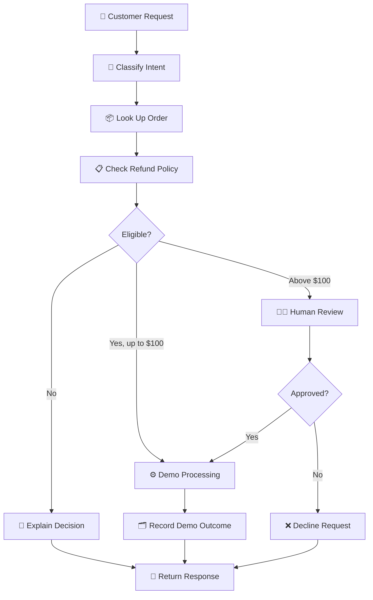

<div align="center">

# ✨ RefundIQ

### LangGraph Customer Support & Refund Agent

**An AI-powered customer support workflow with human-in-the-loop refund approvals.**

<p>
  
  
  
  
</p>

<p>
  
  
</p>

---

### 💫 Intelligent Support. Controlled Decisions. Human Oversight.

[Features](#-features) ·
[Architecture](#-how-it-works) ·
[Installation](#-installation) ·
[Demo Scenarios](#-demo-scenarios) ·
[API](#-api-reference) ·
[Limitations](#-limitations)

</div>

> [!IMPORTANT]
> **Educational demo only.** This project does not connect to a payment processor or transfer real money. Do not expose the unauthenticated review endpoint publicly.

## 🌟 Overview

RefundIQ is a learning project built with **Python, FastAPI, LangGraph, Groq, HTML, CSS, and JavaScript**.

It demonstrates how an AI-assisted support system can classify customer messages, retrieve demo order information, apply refund policies, request human approval, and record demo outcomes in local CSV files.

The project combines an interactive web interface with a backend workflow designed to demonstrate practical agent concepts.

## 🚀 Features

| Feature | Description |
|---|---|
| 💬 Customer Support UI | Responsive web interface for submitting requests |
| 🧠 Intent Classification | Refund, tracking, cancellation, complaint, and general queries |
| 📦 Order Lookup | Retrieves demo order details from CSV data |
| 📋 Refund Policy | Checks the delivery window and refund amount |
| ⚙️ Automated Decisions | Eligible demo refunds up to $100 |
| 🧑‍💼 Human-in-the-Loop | Approval workflow for refunds above $100 |
| 🔄 LangGraph Workflow | Interrupt and resume for human review |
| 🗂️ CSV Ledger | Local demo records and duplicate-refund checks |
| 🤖 Groq Integration | AI classification and replies when configured |
| 🛟 Fallback Handling | Rule-based classification and template responses |
| 🩺 Health Endpoint | Basic server health check |
| 📚 API Documentation | Interactive FastAPI Swagger UI |

## 🧭 How It Works

<div align="center">



</div>

### 💰 Demo Refund Policy

- **7-day window:** The order must have been delivered within the last seven days.
- **Up to $100:** Eligible refunds can be processed automatically in the demo.
- **Above $100:** Requires human approval.
- **Ineligible requests:** The workflow returns an appropriate decision.
- **Duplicate protection:** Previously refunded orders are checked before processing.

*All amounts and refund actions are simulated. No real payments are made.*

## 🛠️ Tech Stack

- **Language:** Python
- **Backend:** FastAPI
- **Agent Workflow:** LangGraph
- **LLM Integration:** Groq via LangChain
- **Frontend:** HTML, CSS, JavaScript
- **Storage:** Local CSV files
- **Server:** Uvicorn

## 📁 Project Structure

```text
langgraph-refund-agent/
│
├── main.py
├── graph.py
├── agents.py
├── tools.py
├── database.py
├── schemas.py
├── requirements.txt
├── .env.example
├── .gitignore
│
├── static/
│   ├── index.html
│   ├── style.css
│   └── script.js
│
└── data/
    ├── orders.csv       # Generated demo data
    └── refunds.csv      # Demo refund ledger
```

*The `data/` files may be generated when the application runs.*

## ⚡ Installation

### 1. Clone the Repository

```powershell
git clone https://github.com/NargisNizam/LangGraph_Refund_Agent.git
cd LangGraph_Refund_Agent
```

> If the repository contains the project inside a nested folder, enter that folder before continuing.

### 2. Create a Virtual Environment

```powershell
py -3.11 -m venv .venv
```

### 3. Activate the Environment

```powershell
.\.venv\Scripts\Activate.ps1
```

### 4. Install Dependencies

```powershell
python -m pip install --upgrade pip
pip install -r requirements.txt
```

### 5. Configure Environment Variables

```powershell
Copy-Item .env.example .env
```

Open `.env` and configure your own Groq API key if you want to use the LLM integration.

```env
GROQ_API_KEY=your_groq_api_key_here
GROQ_MODEL=your_available_model_name
```

Use a model name available to your Groq account. Never upload `.env` or publish your API key.

The project can use its rule-based/template fallback when the LLM is unavailable, provided the fallback paths are correctly configured.

## ▶️ Run the Application

### 1. Check Python Files

```powershell
python -m py_compile main.py schemas.py agents.py graph.py tools.py database.py
```

### 2. Start the Server

```powershell
python -m uvicorn main:app --reload --port 8000
```

If port 8000 is already in use:

```powershell
python -m uvicorn main:app --reload --port 8001
```

### 3. Open the Application

| Resource | URL |
|---|---|
| 🌐 Web Interface | http://127.0.0.1:8000/ |
| 📚 API Documentation | http://127.0.0.1:8000/docs |
| 🩺 Health Check | http://127.0.0.1:8000/health |

For port 8001, replace `8000` with `8001`.

## 🧪 Demo Scenarios

Use a unique `thread_id` for each new request.

| Order ID | Expected Demo Behavior |
|---|---|
| `ORD-1001` | $75 — eligible for automatic demo refund if within the policy window |
| `ORD-1002` | $120 — human approval required if otherwise eligible |
| `ORD-1003` | $350 — human approval required if otherwise eligible |
| `ORD-1004` | Older delivery — refund window expired |
| `ORD-1005` | Previously refunded — duplicate protection |

The application generates seed dates when the demo order CSV is first created. Actual results depend on the stored data and policy implementation.

### Reset Demo Data

Stop the server first, then remove the generated demo CSV files if you want fresh seed data.

```powershell
Remove-Item .\data\orders.csv
Remove-Item .\data\refunds.csv
```

Only run these commands if you are comfortable losing the current demo records.

## 🔌 API Reference

### `POST /support`

Example request:

```json
{
  "thread_id": "demo-unique-1",
  "message": "I want a refund for ORD-1001",
  "order_id": "ORD-1001"
}
```

A successful response may indicate either a completed workflow or pending human approval, depending on the request.

### `POST /review/{thread_id}`

Example request:

```json
{
  "approved": true
}
```

This endpoint resumes a workflow awaiting human review. The exact response depends on the workflow state.

### `GET /health`

Expected response:

```json
{
  "status": "ok"
}
```

## 🔐 Limitations & Security

- **No real payments:** All refunds are simulated.
- **In-memory checkpoints:** Pending approvals may be lost when the server restarts.
- **CSV storage:** Suitable for local learning, not concurrent production transactions.
- **No review authentication:** The review endpoint must not be publicly exposed without proper access control.
- **LLM dependency:** Model availability, configuration, and provider access can change.
- **Production readiness:** Authentication, authorization, input validation, audit logs, persistent workflow checkpoints, and a transactional database would be required before real deployment.

## 🎯 Learning Outcomes

This project demonstrates practical concepts in:

- AI agents and workflow orchestration
- LangGraph interrupt/resume patterns
- Human-in-the-loop decision making
- REST API development with FastAPI
- LLM integration and fallback handling
- Data persistence with CSV files
- Frontend-to-backend communication
- Error handling and responsible AI application design

## 🔮 Future Improvements

- Add authenticated admin review.
- Use PostgreSQL for durable order and refund storage.
- Persist workflow checkpoints across restarts.
- Add unit tests and integration tests.
- Improve monitoring, structured logging, and audit trails.
- Add Docker support and deployment documentation.

## 👩‍💻 Author

**Nargis Nizam**

AI & Data Science Learner | Python | FastAPI | LangGraph

- GitHub: [@NargisNizam](https://github.com/NargisNizam)

---

<div align="center">

### 💖 Built for Learning and Experimentation

*Exploring AI agents, workflow automation, and human oversight — one project at a time.*

</div>
